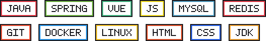
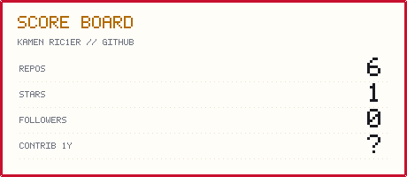
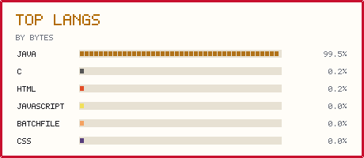
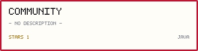
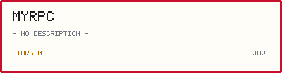
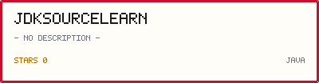
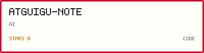
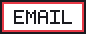
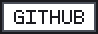

<!--
  ═══════════════════════════════════════════════════════════════
  PIXEL KAMEN RIDER PROFILE
  ── REPO ───────────────────────────────────────────────────────
  github.com/KamenRic1er/KamenRic1er
  assets/ holds the generated SVG art; tools/ regenerates it.
  The contribution snake is rebuilt by .github/workflows/snake.yml
  every 12h and on every push to main.
  Stats / top-langs / project cards are self-generated into
  assets/generated by .github/workflows/stats.yml (daily + manual).

  ── NOTES ──────────────────────────────────────────────────────
  · Contact email is pcwl1017@163.com (badge links to mailto).
  · The ABOUT paragraph is starter copy - edit it freely.
  · All pixel art is generated: tweak tools/gen_pixel_assets.mjs
    and re-run   node tools/gen_pixel_assets.mjs
  · Stats cards: node tools/gen_stats.mjs   (GITHUB_TOKEN adds
    the 1y contribution count; without it that row shows '?')
  ═══════════════════════════════════════════════════════════════
-->

<!-- ══════════════ PIXEL BANNER ══════════════ -->
<picture>
  <source media="(prefers-color-scheme: dark)" srcset="assets/banner-dark.svg" />
  <source media="(prefers-color-scheme: light)" srcset="assets/banner-light.svg" />
  
</picture>

<!-- ══════════════ TYPING ══════════════ -->
<picture>
  <source media="(prefers-color-scheme: dark)" srcset="https://readme-typing-svg.demolab.com?font=Press+Start+2P&amp;size=18&amp;duration=3200&amp;pause=900&amp;color=FFC300&amp;center=true&amp;vCenter=true&amp;width=760&amp;lines=%3E+PRESS+START...;HENSHIN!+KAMEN+RIC1ER;JAVA+%2F+SPRING+%2F+VUE;RIDER+OF+THE+JVM" />
  <source media="(prefers-color-scheme: light)" srcset="https://readme-typing-svg.demolab.com?font=Press+Start+2P&amp;size=18&amp;duration=3200&amp;pause=900&amp;color=C8102E&amp;center=true&amp;vCenter=true&amp;width=760&amp;lines=%3E+PRESS+START...;HENSHIN!+KAMEN+RIC1ER;JAVA+%2F+SPRING+%2F+VUE;RIDER+OF+THE+JVM" />
  
</picture>

<picture>
  <source media="(prefers-color-scheme: dark)" srcset="assets/divider-dark.svg" />
  <source media="(prefers-color-scheme: light)" srcset="assets/divider-light.svg" />
  
</picture>

<!-- ══════════════ ABOUT ══════════════ -->
### ► PLAYER 1 // ABOUT

Backend developer with the belt always on. I build services with **Java &amp; Spring**, craft interfaces with **Vue**, and read JDK source code for fun. RPC frameworks, forums, weird side quests — if it compiles, it rides.

<!-- ══════════════ TECH STACK ══════════════ -->
### ► POWER-UPS // TECH STACK

<picture>
  <source media="(prefers-color-scheme: dark)" srcset="assets/tech-dark.svg" />
  <source media="(prefers-color-scheme: light)" srcset="assets/tech-light.svg" />
  
</picture>

<!-- ══════════════ GITHUB STATS ══════════════ -->
### ► SCORE BOARD // GITHUB STATS

<a href="https://github.com/KamenRic1er">
  <picture>
    <source media="(prefers-color-scheme: dark)" srcset="assets/generated/stats-dark.svg" />
    <source media="(prefers-color-scheme: light)" srcset="assets/generated/stats-light.svg" />
    
  </picture>
</a>
<a href="https://github.com/KamenRic1er?tab=repositories">
  <picture>
    <source media="(prefers-color-scheme: dark)" srcset="assets/generated/langs-dark.svg" />
    <source media="(prefers-color-scheme: light)" srcset="assets/generated/langs-light.svg" />
    
  </picture>
</a>

<picture>
  <source media="(prefers-color-scheme: dark)" srcset="https://streak-stats.demolab.com?user=KamenRic1er&amp;background=101218&amp;stroke=E63946&amp;ring=FFC300&amp;fire=FFC300&amp;currStreakNum=C9CCD4&amp;sideNums=E63946&amp;currStreakLabel=C9CCD4&amp;sideLabels=E8E8E2&amp;dates=8B90A0" />
  <source media="(prefers-color-scheme: light)" srcset="https://streak-stats.demolab.com?user=KamenRic1er&amp;background=FFFDF8&amp;stroke=C8102E&amp;ring=B26B00&amp;fire=C8102E&amp;currStreakNum=C8102E&amp;sideNums=4A4E58&amp;currStreakLabel=C8102E&amp;sideLabels=4A4E58&amp;dates=8A8F9C" />
  
</picture>

<!-- ══════════════ CONTRIBUTION SNAKE ══════════════ -->
### ► CONTRIBUTION MATRIX

<picture>
  <source media="(prefers-color-scheme: dark)" srcset="https://raw.githubusercontent.com/KamenRic1er/KamenRic1er/output/github-snake-cyber.svg" />
  <source media="(prefers-color-scheme: light)" srcset="https://raw.githubusercontent.com/KamenRic1er/KamenRic1er/output/github-snake-cyber-light.svg" />
  
</picture>

<!-- ══════════════ FEATURED PROJECTS ══════════════ -->
### ► STAGE SELECT // PROJECTS

<a href="https://github.com/KamenRic1er/community">
  <picture>
    <source media="(prefers-color-scheme: dark)" srcset="assets/generated/pin-1-dark.svg" />
    <source media="(prefers-color-scheme: light)" srcset="assets/generated/pin-1-light.svg" />
    
  </picture>
</a>
<a href="https://github.com/KamenRic1er/MyRPC">
  <picture>
    <source media="(prefers-color-scheme: dark)" srcset="assets/generated/pin-2-dark.svg" />
    <source media="(prefers-color-scheme: light)" srcset="assets/generated/pin-2-light.svg" />
    
  </picture>
</a>
<a href="https://github.com/KamenRic1er/JDKSourceLearn">
  <picture>
    <source media="(prefers-color-scheme: dark)" srcset="assets/generated/pin-3-dark.svg" />
    <source media="(prefers-color-scheme: light)" srcset="assets/generated/pin-3-light.svg" />
    
  </picture>
</a>
<a href="https://github.com/KamenRic1er/atguigu-note">
  <picture>
    <source media="(prefers-color-scheme: dark)" srcset="assets/generated/pin-4-dark.svg" />
    <source media="(prefers-color-scheme: light)" srcset="assets/generated/pin-4-light.svg" />
    
  </picture>
</a>

<!-- ══════════════ CONTACT ══════════════ -->
### ► CONTINUE? // CONTACT

<a href="mailto:pcwl1017@163.com">
  <picture>
    <source media="(prefers-color-scheme: dark)" srcset="assets/badge-email-dark.svg" />
    <source media="(prefers-color-scheme: light)" srcset="assets/badge-email-light.svg" />
    
  </picture>
</a>
<a href="https://github.com/KamenRic1er">
  <picture>
    <source media="(prefers-color-scheme: dark)" srcset="assets/badge-github-dark.svg" />
    <source media="(prefers-color-scheme: light)" srcset="assets/badge-github-light.svg" />
    
  </picture>
</a>

 
 

<picture>
  <source media="(prefers-color-scheme: dark)" srcset="assets/divider-dark.svg" />
  <source media="(prefers-color-scheme: light)" srcset="assets/divider-light.svg" />
  
</picture>

&copy; 2026 KAMEN RIC1ER &middot; INSERT COIN TO CONTINUE

